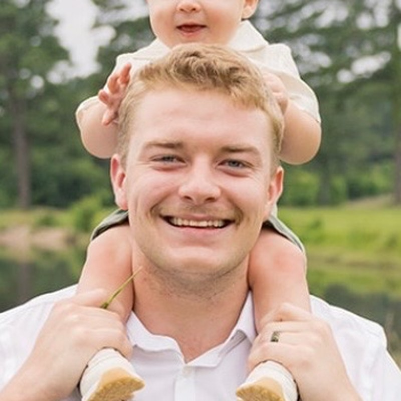

<figure class="portrait"></figure>

I am a fourth-year medical student at the UAB Heersink School of Medicine and an incoming PhD student in Neuroengineering (2027) at the University of Alabama at Birmingham. I am in Dr. Harrison Walker's lab, where I work on machine-learning decoding of subthalamic nucleus recordings, including evoked resonant neural activity (ERNA), for adaptive deep brain stimulation and brain–computer interfaces.

My work to date spans neuromodulation for movement and sleep disorders, evidence synthesis and meta-analysis in neurosurgery and neurology, and equitable access to neurological care in low- and middle-income countries. Before medicine I studied chemistry at Birmingham-Southern College, where I also played football, and I grew up working on a potato farm in northeast Alabama. I am also a 2026–2027 Doximity Op-Med Medical Writing Fellow.

Open to research collaborations, speaking, and conversations with people building neurotechnology.

## Now {#now}

::: entry
{{now}}

- Research in the Walker Lab: decoding subthalamic nucleus recordings made during DBS surgery, including evoked resonant neural activity (ERNA).
- Writing the first essays for the 2026–27 Doximity Op-Med Fellowship.
:::

## Curriculum Vitae {#cv}

[Download the full CV (PDF)](/cv.pdf)

### Education

::: entry
2027 – 2032 (exp.)

**PhD, Neuroengineering**\
University of Alabama at Birmingham, Birmingham, AL
:::

::: entry
2023 – 2027 (exp.)

**MD, Distinction in Health Equity**\
UAB Heersink School of Medicine, Birmingham, AL
:::

::: entry
2020 – 2023

**B.S., Chemistry, *magna cum laude***\
Birmingham-Southern College, Birmingham, AL
:::

### Honors and Fellowships

::: entry
2026 – 2027

Doximity Op-Med Medical Writing Fellowship
:::

::: entry
2026 – present

Alpha Omega Alpha (AOA) Honor Medical Society
:::

::: entry
2025 – present

Gold Humanism Honor Society (GHHS)
:::

::: entry
2024 – present

Health Equity Scholar, UAB Heersink School of Medicine
:::

## Research Experience {#experience}

::: entry
2026 – present

**Walker Research Lab, UAB Neurology**\
Dr. Harrison Walker

- Machine-learning decoding of subthalamic nucleus recordings, including evoked resonant neural activity (ERNA), for adaptive deep brain stimulation and brain–computer interfaces; planned dissertation laboratory for the Neuroengineering PhD
:::

::: entry
2024 – present

**Global Neurosurgery Research Group, Mission:Brain Foundation**\
Coordinator

- Coordinate roughly 35 international medical graduates, mainly from low- and middle-income countries, in a multi-project research group advancing equitable access to neurological care.
- Lead members across many time zones and backgrounds toward shared goals; sharpen scientific writing, study design, and critical review across the group.
:::

::: entry
2023 – present

**Holland Clinical Research Lab, UAB Neurosurgery**\
Dr. Marshall Holland

- Joined as a first-year medical student on a single systematic review; grew into co-leading lab meetings and mentoring younger medical students and undergraduates.
- Chart review, data collection, study design, and manuscript writing; managed submission and revision for multiple manuscripts and IRB protocols.
- Designed independent studies and authored original IRB protocols.
:::

::: entry
2022 – 2023

**Immunology Research, UAB**\
Dr. Chander Raman

- Investigated ultraviolet B-induced immune suppression in murine models and cell lines, including vitamin D3 effects on samples from multiple sclerosis and lupus patients.
- Cell culture, flow cytometry, and confocal microscopy; cryosectioning and staining of lymph node, spleen, and skin tissue.
- High-dimensional flow cytometry analysis in FlowJo (tSNE, UMAP, TriMap).
- Oversaw breeding, treatment, and upkeep of multiple transgenic mouse lines.
:::

::: entry
2021 – 2022

**Enzyme Kinetics Research, Birmingham-Southern College**\
Dr. Kate Hayden

- Expressed novel enzymes from vector-transfected plasmids; purified target proteins by SDS-PAGE, centrifugal size exclusion, and His-tag affinity chromatography.
- Kinetic assays on tvGAPDH, cdGAPDH, and cpPK; Michaelis–Menten and Lineweaver–Burk modeling of K~m~ and V~max~ for medicinal-chemistry collaborators.
:::

## Leadership and Service {#service}

::: entry
2023 – present

**Mission:Brain Foundation**\
UAB Chapter President • Regional Chair of Outreach • Coordinator, Global Neurosurgery Research Group

- Launched Project:RISE (annual lecture on research equity for international medical graduates in low- and middle-income countries), NeuroCamp (a year-long neuroscience curriculum for Birmingham middle school students), and a spina bifida prevention campaign promoting corn masa folate fortification.
- As Outreach Chair, direct fundraising, inventory, and equipment logistics supporting Sierra Leone's first publicly accessible neurosurgical service, in coordination with the WFNS and the Ministry of Health.
- Coordinate the roughly 35-member Global Neurosurgery Research Group; oversee a manuscript bundle mapping global neurosurgery stakeholders in line with the Boston Declaration.
:::

::: entry
2024 – present

**Alabama House Bill 384: Corn Masa Folic Acid Fortification**\
Health policy and advocacy

- Worked with the Children's of Alabama pediatric neurosurgery team to support passage of state legislation establishing folic acid fortification of corn masa, addressing the elevated prevalence of spina bifida in Hispanic communities.
:::

## Talks {#talks}

### Invited Lectures

::: entry
July 2024

Rural Health. Social Determinants of Health Grand Rounds, UAB Heersink School of Medicine.
:::

::: entry
2024

Systematic Review Methodology. Project:RISE Research Equity Lecture, UAB.
:::

### Oral Presentations

::: entry
June 2026

**Thrash GW**, Holland MT. Restless legs syndrome and spinal cord stimulation. UAB Neurosurgery Teaching Conference, Birmingham, AL.
:::

::: entry
2025

**Thrash GW**, Boudreau H\*, Stacey GK, Razi R, Rives C, Massie H, Brockington D, Cho H, George J, Holland MT. Diverging perceptions between program leadership and applicants on the neurosurgery arms race to research: a single-center survey. Galbraith Neurosurgery Research Symposium, Birmingham, AL, 2025. \*Presented by second author.
:::

::: entry
April 24, 2025

**Thrash GW**. UAB Mission:Brain chapter pledge. Boston Declaration of Global Neurosurgery, Kennedy Center, Boston, MA.
:::

::: entry
Spring 2024

**Thrash GW**, Sun Y, Del Bene V, Bentley N. Intracranial recordings toward brain mapping of executive function: a systematic review. NeuroGateways Consortium of Neuroengineering and Brain-Computer Interfaces, Birmingham, AL.
:::

::: entry
May 2023

**Thrash GW**, Mier-Aguilar C, Xu H, Raman C. UVB induction of senescent cells. Senior thesis, Birmingham-Southern College Department of Chemistry, Birmingham, AL.
:::

Posters and abstracts are listed with the [publications](/publications/#posters).

## Teaching {#teaching}

::: entry
2024 – present

**Research Mentorship, UAB Heersink School of Medicine**\
Medical students

- Mentor medical students in study design, scientific writing, and residency planning; mentees are co-authors on published papers, manuscripts under review, and conference presentations.
:::

::: entry
2024 – 2025

**Multidisciplinary Research Stewardship, UAB**\
Neurosurgery Chair

- Hosted office hours and presentations on research fundamentals for medical students and connected students interested in neurosurgery with career mentors.
:::

::: entry
2021 – 2023

**Birmingham-Southern College**\
Chemistry tutor; teaching assistant, cell and molecular biology laboratory

- Tutored analytical and organic chemistry and biochemistry; led laboratory sections, including grading.
:::

## For Organizers {#organizers}

Bios and a headshot you may use as-is. For dates and topics, email [gthrash@uab.edu](mailto:gthrash@uab.edu).

### Short Bio

::: bio
Garrett Thrash is an MD candidate (Class of 2027) at the UAB Heersink School of Medicine and an incoming PhD student in Neuroengineering at the University of Alabama at Birmingham. In Dr. Harrison Walker's lab he works on machine-learning decoding of subthalamic nucleus recordings, including evoked resonant neural activity (ERNA), for adaptive deep brain stimulation. He has co-authored {{pub_count}} peer-reviewed papers, coordinates the Mission:Brain Global Neurosurgery Research Group, and is a 2026–27 Doximity Op-Med Writing Fellow.
:::

### Long Bio

::: bio
Garrett Thrash is an MD candidate (Class of 2027) at the UAB Heersink School of Medicine and an incoming PhD student in Neuroengineering at the University of Alabama at Birmingham. He is in Dr. Harrison Walker's lab, where his research uses machine learning to decode subthalamic nucleus recordings, including evoked resonant neural activity (ERNA), with the goal of stimulation that responds to what the brain is doing. His earlier research, in Dr. Marshall Holland's group, produced systematic reviews and meta-analyses in neuromodulation and neurosurgery, including work on deep brain and spinal cord stimulation for restless legs syndrome. He has co-authored {{pub_count}} peer-reviewed papers. He coordinates the roughly 35-member Mission:Brain Global Neurosurgery Research Group, has served as president of the UAB Mission:Brain chapter and its regional outreach chair supporting Sierra Leone's first public neurosurgical service, and worked with the Children's of Alabama pediatric neurosurgery team on Alabama House Bill 384, which established folic acid fortification of corn masa. He is a member of Alpha Omega Alpha and the Gold Humanism Honor Society and a 2026–27 Doximity Op-Med Writing Fellow. Before medicine he studied chemistry and played football at Birmingham-Southern College, and he grew up working on a potato farm in northeast Alabama.
:::

### Headshot

<a href="/headshot.jpg" download="garrett-thrash-headshot.jpg">Download headshot (JPG, 900 × 900)</a>
