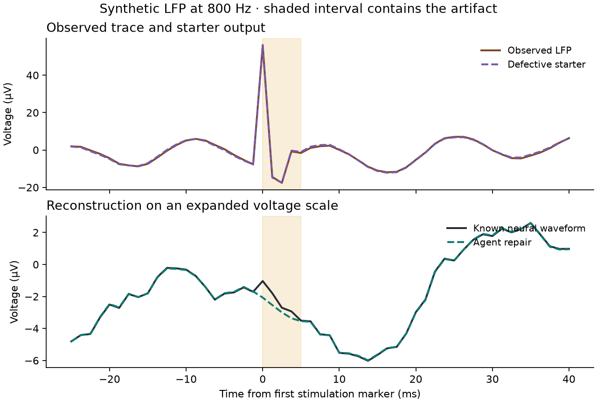

::: entry
Status

Working release
:::

::: entry
Role

Agentically engineered by me
:::

::: entry
Stack

Python, NumPy, SciPy, pytest
:::

::: entry
Code

Private
:::

A broken local field potential (LFP) pipeline can pass its interface check. It returns a finite voltage trace and a plausible beta-power number. NeuroEval asks whether that trace actually recovers the neural signal. A coding agent gets a defective starter pipeline and synthetic recordings. A hidden grader holds the clean waveforms and scores the repair.

- Each recording in the main suite is 12 seconds of synthetic LFP: aperiodic background, a 5 to 9 Hz rhythm, bursting 17 to 25 Hz beta, 60 Hz mains interference, and trains of stimulation pulse artifacts. Cases run at 500, 800 and 1000 Hz.
- The grader scores waveform error outside and inside the stimulation windows, residual 60 Hz, and beta-power error. A correlation gate cuts credit for traces that do not follow the real signal, so a made-up beta oscillation scores zero.
- Each candidate runs each case in a fresh isolated process, and every run replays from a seed.

## Results

Demonstration suite, eight recordings:

| Submission | Mean score / 100 |
| --- | ---: |
| Reference solution | 100.00 |
| Blinded agent repair | 100.00 |
| Partial repair, stimulation artifacts left in | 72.30 |
| Defective starter | 16.97 |
| Fabricated 20 Hz signal | 0.00 |

The partial repair shows why the in-window score matters. On the first 500 Hz case, it tracked the neural waveform almost perfectly outside the stimulation windows (correlation 0.9998), yet its error inside them was 12 times the clean signal's RMS voltage. On eight new recordings generated from a seed chosen by an independent reviewer, the agent's repair cut median beta-power error from 83.15% in the starter to 0.086%.

## How it was built

NeuroEval is one of 11 biomedical research tools I directed parallel coding agents to build, including tools for manuscript tables, evidence synthesis, neuroscience dataset discovery, and literature verification. Each tool passes automated tests and a review by a separate agent, tied to the exact source version, then end-to-end trials on public or synthetic inputs.

[Agentic engineering](/research/#agentic)
